# Tablón de anuncios (Práctica final 2.8)

Aplicación MVC en PHP sin framework: usuarios, anuncios con categoría, comentarios, buscador, permisos por autor y protección CSRF.

## Capturas

Hechas con los datos de prueba de `database.sql` (entrando como `ana`).

### Tablón y buscador

| Portada (sin sesión) | Portada (con sesión) |
|---|---|
| 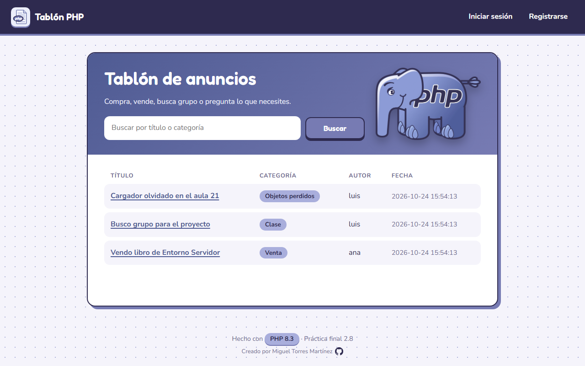 | 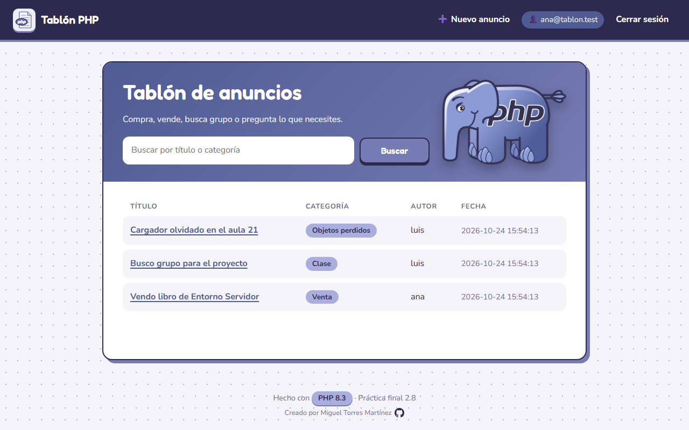 |

| Buscador (`/posts?q=venta`) | En el móvil |
|---|---|
| 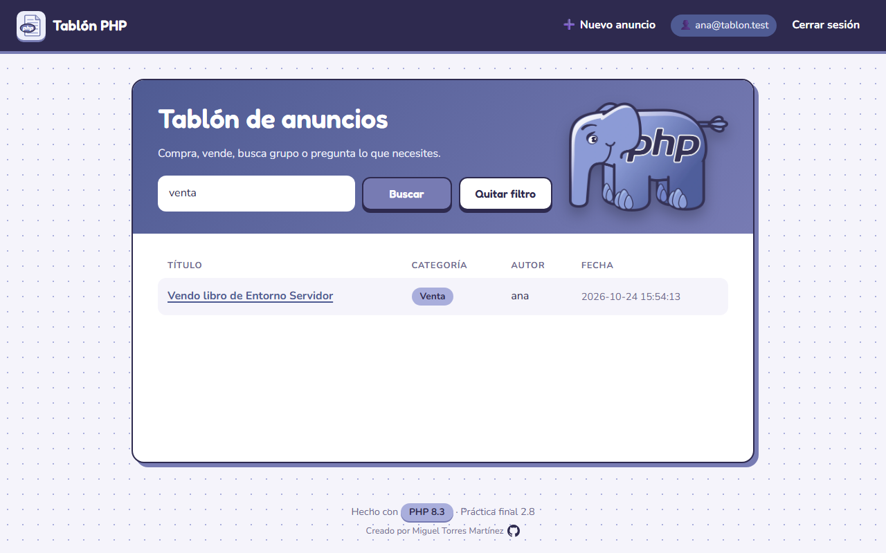 | 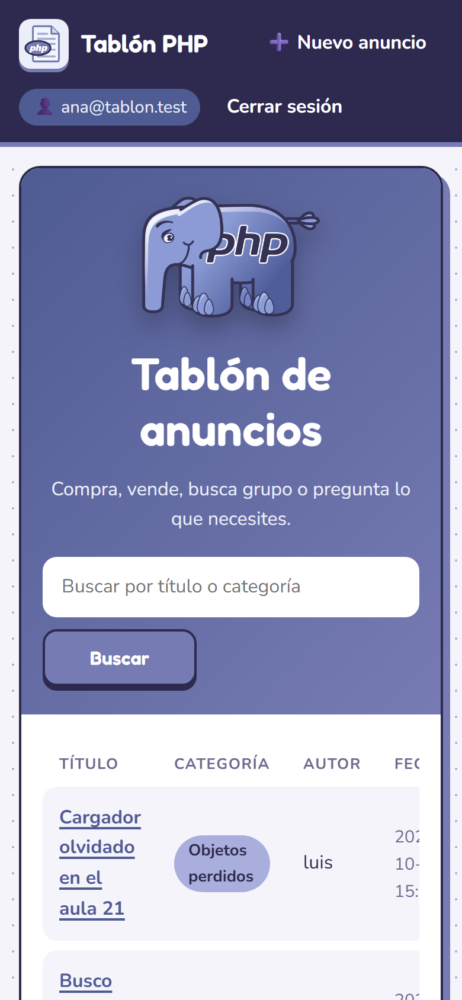 |

### Usuarios

| Iniciar sesión | Registrarse |
|---|---|
| 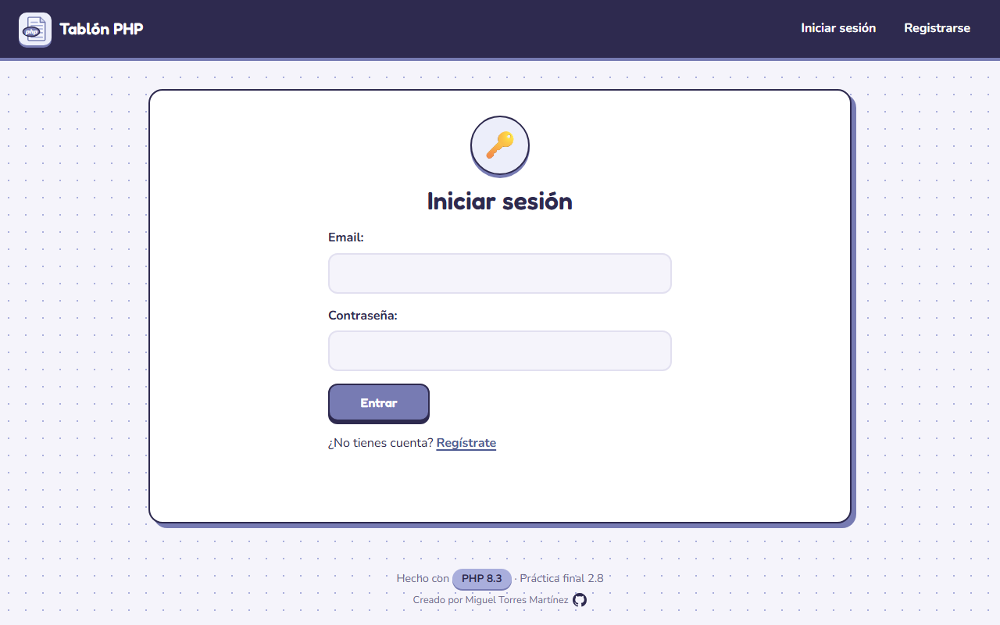 | 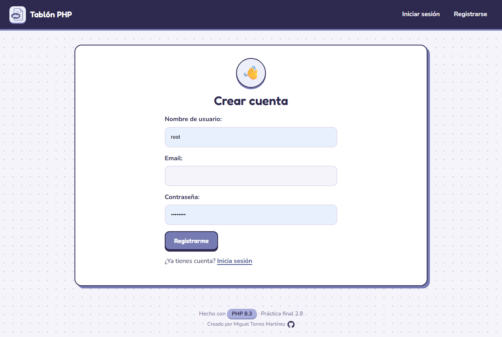 |

### Anuncios y comentarios

| Anuncio mío: puedo editar y borrar | Anuncio de otro: no salen los botones |
|---|---|
| 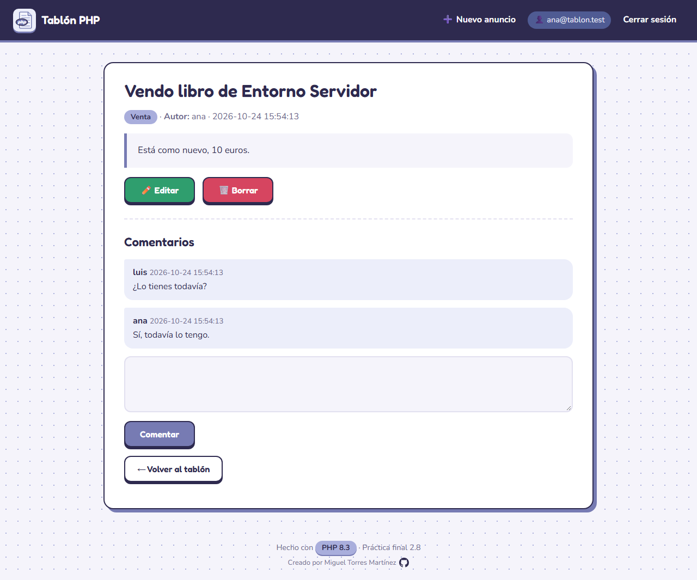 | 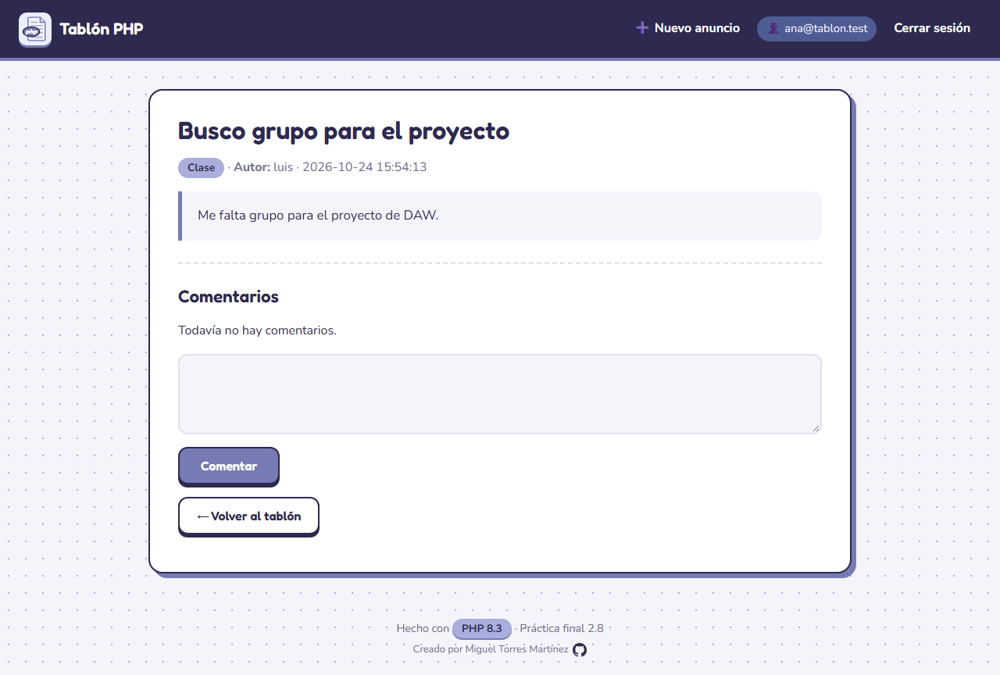 |

| Nuevo anuncio | Editar anuncio (`/posts/edit/1`) |
|---|---|
| 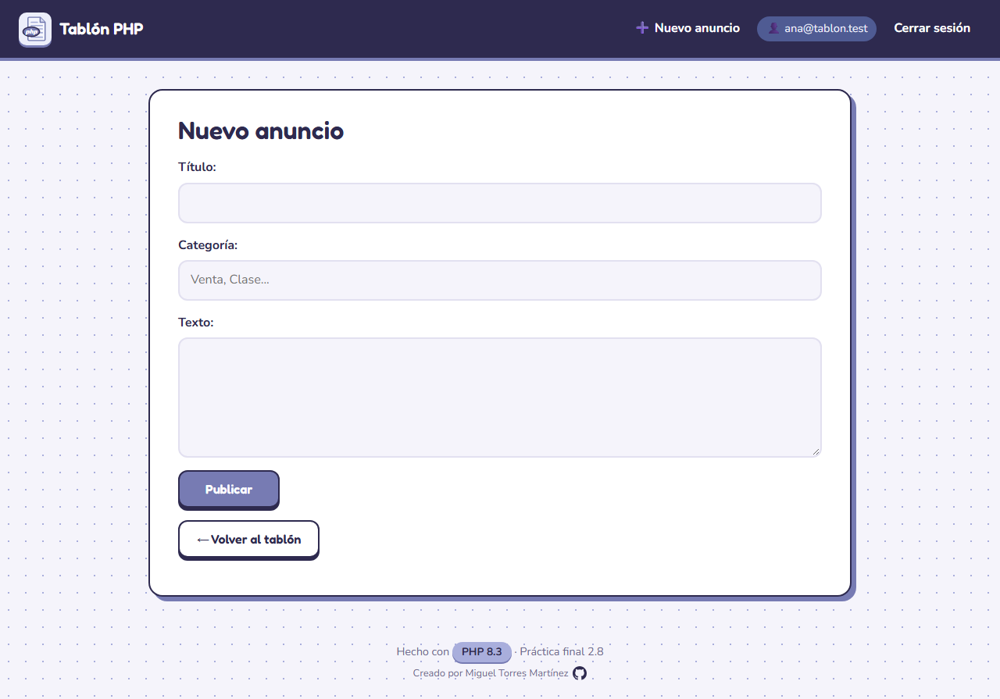 | 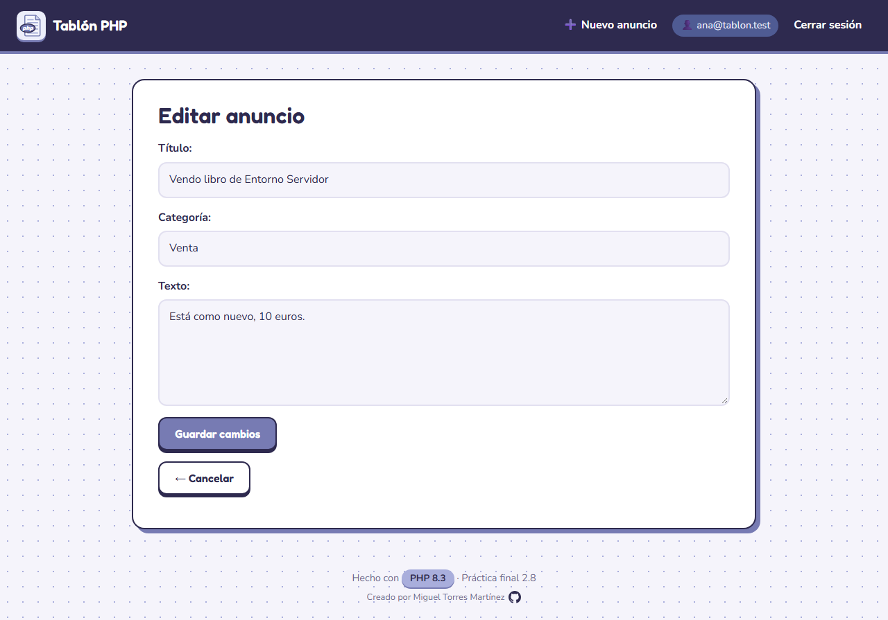 |

Al publicar un anuncio sale la pantalla de carga con el elefante de PHP corriendo:

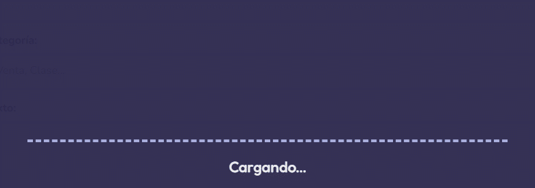

### Errores

| 403: editar un anuncio de otro (`/posts/edit/2`) | 404: un anuncio que no existe (`/posts/999`) |
|---|---|
| 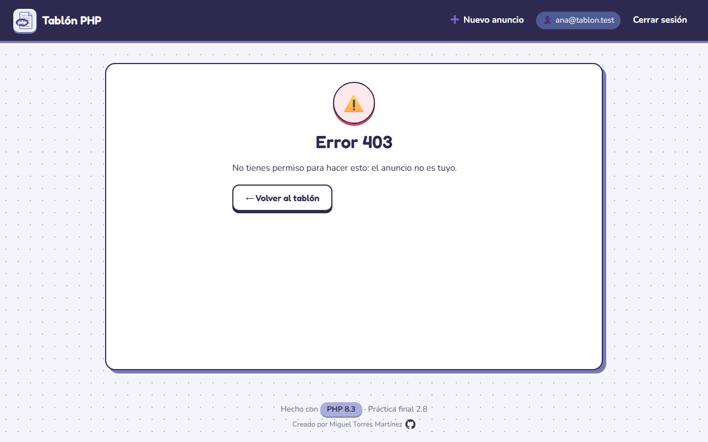 | 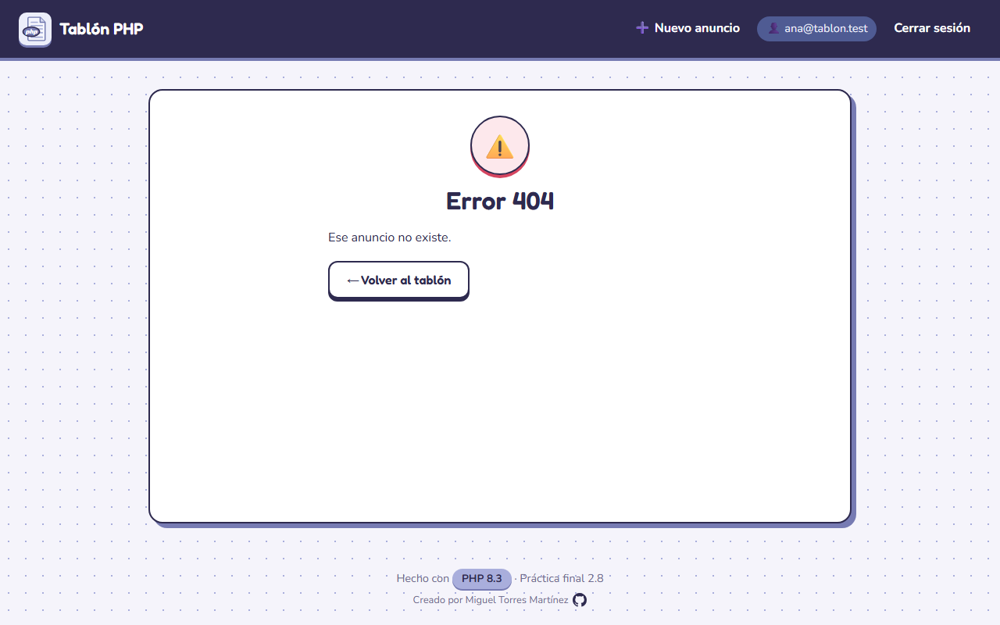 |

## Requisitos

- Docker Desktop instalado y **abierto** (el icono de la ballena debe estar en marcha).

## Arrancar

```bash
docker compose up -d
```

- Web: http://localhost:8080
- phpMyAdmin: http://localhost:8081 (root / Tablon_2026)

La primera vez se crea la base de datos con `database.sql` y el contenedor copia `config.example.php` a `config.php`.

La **primera vez** puede tardar un minuto o más, porque MySQL tiene que crear la base de datos e importar `database.sql`. Para saber si ya está listo:

```bash
docker compose ps
```

Cuando `mysql` aparezca como `healthy`, la web ya funciona.

## Si el puerto 8080 u 8081 está ocupado

Si sale un error como `port is already allocated`:

1. Para otros proyectos con Docker: `docker compose down` en su carpeta.
2. O cierra el programa que use ese puerto.
3. O cambia el número de la izquierda en `docker-compose.yml` (por ejemplo `"8082:80"`) y abre http://localhost:8082.

Para empezar de cero (borrar la base de datos y volver a crearla):

```bash
docker compose down -v
docker compose up -d
```

## Usuarios de prueba

1. `ana@tablon.test` con contraseña `1234`
2. `luis@tablon.test` con contraseña `1234`

## Estructura

```
public/         index.php (front controller) y .htaccess
public/css/     style.css (todo el diseño)
public/js/      ojo-elefante.js (el ojo sigue al ratón) y carga.js (pantalla de carga)
public/img/     el elefante de PHP y el icono de archivo PHP
src/Core/       Database (acceso a datos), Router, Controller (base)
src/Models/     BaseModel (abstracta), User, Post, Comment
src/Controllers AuthController, PostController, CommentController
src/Views/      vistas (auth, posts, partials)
database.sql    tablas + datos de prueba
docs/capturas/  capturas de la aplicación (las del README)
```

## Rutas

Las URLs son "limpias" (paso 7 opcional): el id va dentro de la URL.

- `/posts` → listado (y buscador con `?q=`)
- `/posts/3` → ver un anuncio
- `/posts/edit/3` → editar
- POST `/posts/update/3` y `/posts/delete/3` → guardar cambios y borrar

## Diseño

La web tiene un diseño propio con los colores del logo de PHP:

- En la portada está el elefante de PHP, y su ojo sigue al ratón.
- Al publicar un anuncio sale una pantalla de carga con el elefante corriendo.
- Se ve bien también en el móvil.

Las letras se cargan de Google Fonts: sin internet la web funciona igual, pero con la letra normal del sistema.

El orden en el que leo el código está en [PASOS.md](PASOS.md), dónde mirar según cada duda en [Helipuerto.md](Helipuerto.md) y las pruebas en [TESTING.md](TESTING.md).
